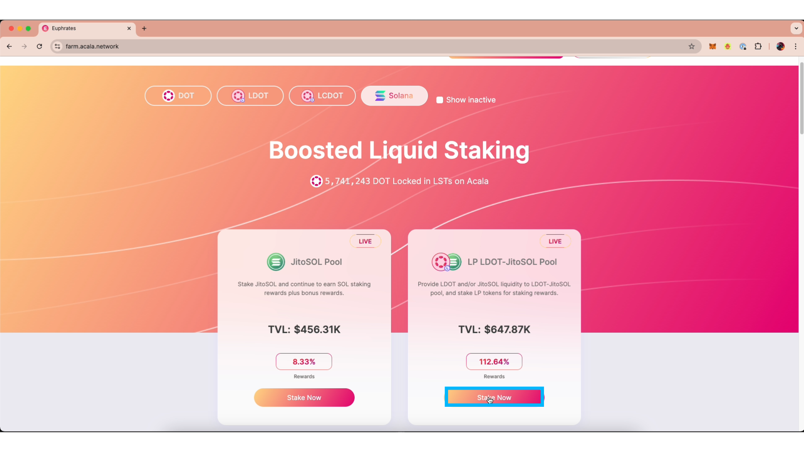
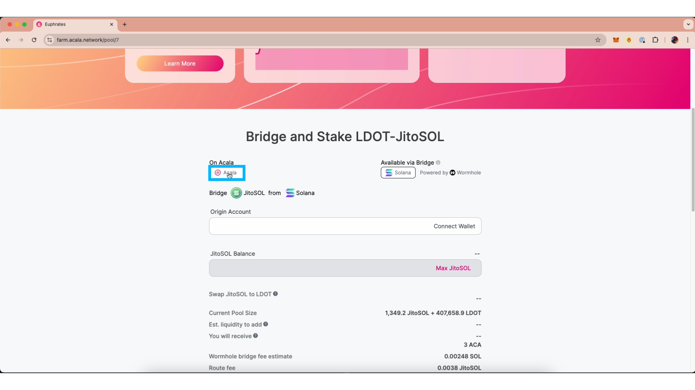
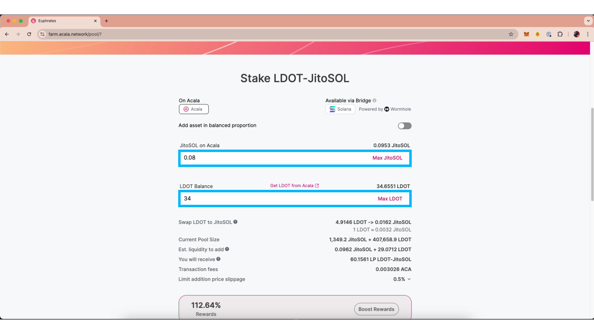
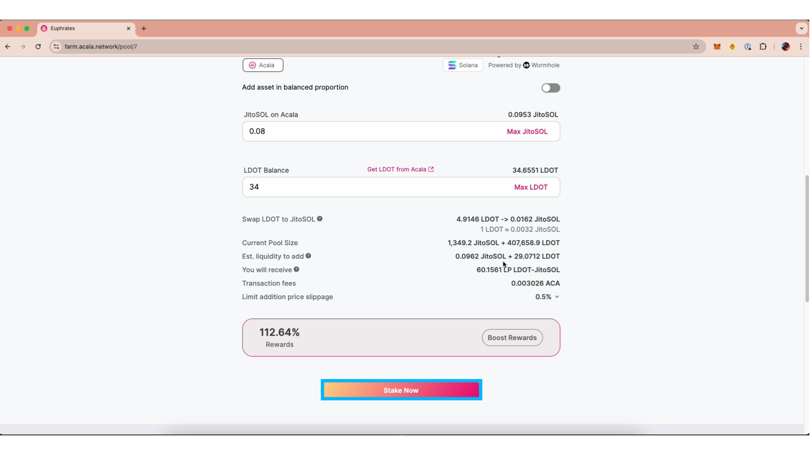
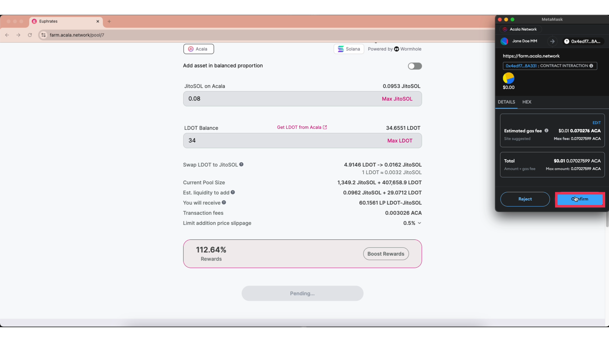
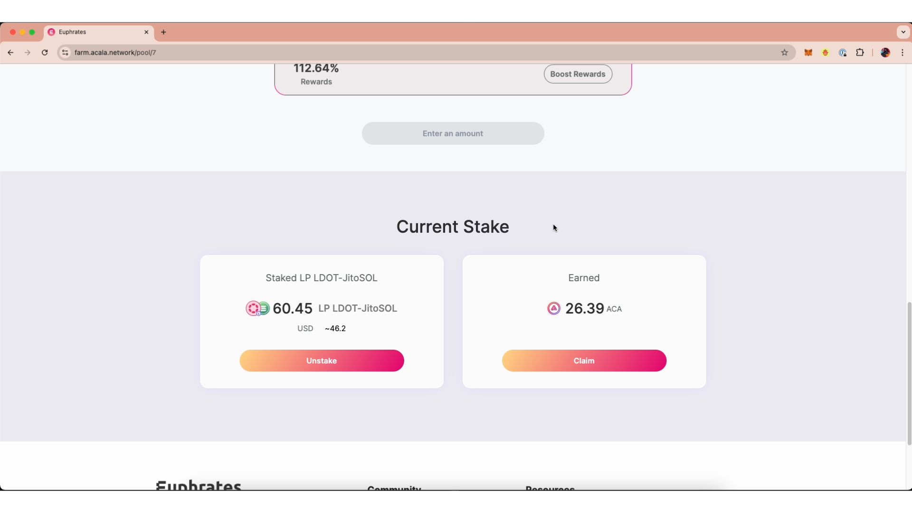

# Stake JitoSOL-LDOT LP


Video Walk-Through&#x20;


### **Step 1: Visit** [**https://farm.acala.network/**](https://farm.acala.network/) **and connect your wallet.**

<figure><figcaption></figcaption></figure>

### **Step 2: Go to the LP LDOT-JitoSOL Pool.**

<figure><figcaption></figcaption></figure>

### **Step 3: Ensure you are "on Acala" if the assets are already on Acala Network.**&#x20;

If you need to bridge assets over, you can use the bridging feature by ensuring Solana is active under "Available via Bridge".&#x20;

<figure><figcaption></figcaption></figure>

### **Step 4: Enter the amount of JitoSOL and/or LDOT you wish to commit.**

Any amount can be committed as the Asset Router will balance the tokens evenly into LP tokens.

<figure><figcaption></figcaption></figure>

### **Step 5: Click "Stake Now" and confirm the spending limits.**

<figure><figcaption></figcaption></figure>

<figure><figcaption>
Spending limits are used as a preventative measure to allow the protocol to spend a maximum amount of tokens for a transaction. The first time you stake you will be asked to confirm a spending limit. You will only be asked this once at the beginning unless you wish to stake an amount greater than the spending limit you first approve. 
</figcaption></figure>

### **Step 6: Sign the staking transaction.**

<figure><figcaption></figcaption></figure>

### LP staking complete!&#x20;

You can scroll down to the bottom of the page to see your balance and accumulated reward.

<figure><figcaption></figcaption></figure>
